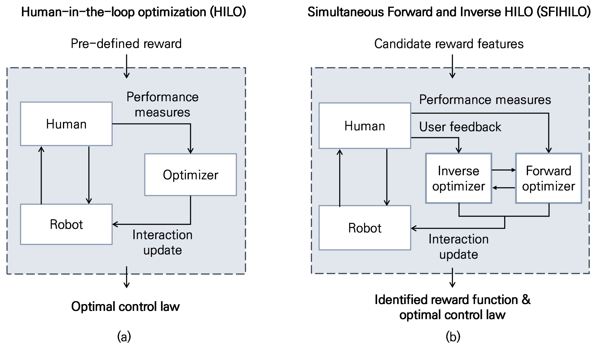
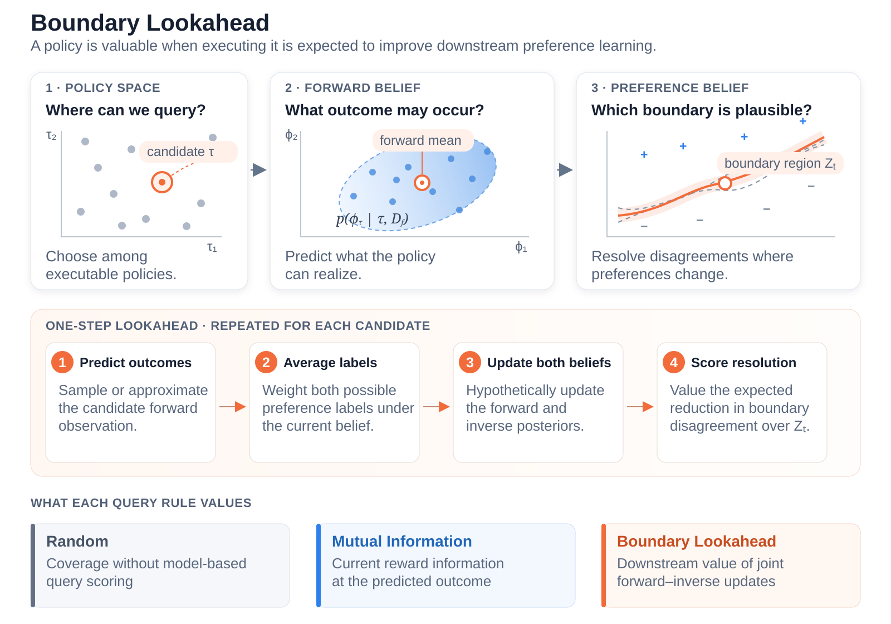

# Simultaneous Forward and Inverse Human-in-the-Loop Optimization (SFIHILO)

Kyeongwon Park and Steven H. Collins · **Accepted at CoRL 2026**

[Paper](https://arxiv.org/abs/2609.22630) ·
[Quick Start](#quick-start) ·
[Main Simulation Results](#reproduce-the-main-simulation-results) ·
[Active Querying](#active-querying-with-boundary-lookahead) ·
[Citation](#citation)

<details>
<summary>Abstract</summary>

Subjective user experience is important to human–robot interaction, but
the outcomes users value, and how those preferences vary across individuals and
contexts, are often unknown. While inverse learning approaches using human data
can help identify user rewards, in many assistive settings the experimental costs of
executing a control policy, measuring biomechanical or physiological outcomes,
and collecting user feedback often limit the number of queries and optimization
iterations. Here, we present Simultaneous Forward and Inverse Human-In-the-Loop
Optimization (SFIHILO), which efficiently infers individual-specific reward
functions from preferences over human outcomes and identifies a final control policy
that maximizes the learned reward. SFIHILO bootstraps a forward model to
predict user outcomes from control policies, uses this model for active querying
to accelerate inverse reward learning, and then optimizes the final control policy
without additional user trials. We score candidate policies by their expected
reduction in uncertainty across both forward and inverse beliefs, targeting a
regional preference boundary to robustly inform this simultaneous learning process.
In simulation, we show that SFIHILO was effective across user heterogeneity, outcome
dimensionalities, precision requirements, noise levels, and nonstationarity;
compared with mutual information approaches, the proposed active querying strategy
significantly improved sample efficiency in inverse learning while preserving
forward model accuracy. This approach demonstrates the potential to infer latent
human goals, enabling more transferable and effective human–robot interaction.

</details>

<p align="center">
  
</p>

**From a predefined objective to a learned, individualized reward.** (a) Conventional
human-in-the-loop optimization (HILO) optimizes robot control to maximize a
predefined objective. (b) SFIHILO infers individual-specific reward functions from
preferences and identifies a robot control policy that maximizes the learned
reward. It includes an active querying method to accelerate this simultaneous
learning process.

This repository provides the simulation code, experiment configurations,
precomputed data, and plotting scripts for the paper's main simulation results.

## Quick Start

Clone the repository and install the dependencies in a fresh Python environment,
then run a small sanity check:

```bash
git clone https://github.com/kyeongwon-park/SFIHILO.git
cd SFIHILO
python -m pip install -r requirements.txt
python scripts/run_experiment.py --config configs/smoke.json
```

The scripts add `src/` to the Python import path automatically.

A successful run finishes without exceptions and creates results for
`Random`, `Mutual Information`, and `Boundary Lookahead`:

- `results/smoke/results.npz`: raw arrays for each method and metric
- `results/smoke/summary.csv`: means and 95% confidence intervals
- `results/smoke/metadata.json`: sanitized configuration and result metadata

The smoke configuration is intentionally tiny; use it to check the installation.
For a longer demonstration, run:

```bash
python scripts/run_experiment.py --config configs/demo.json
```

## Reproduce the Main Simulation Results

Recreate the paper's main simulation results from the included precomputed
data, without rerunning the experiments:

```bash
python scripts/plot_figure2.py --results-dir results --output-dir figures
```

This writes:

- `figures/figure2.pdf`
- `figures/figure2.png`

To also save each panel separately:

```bash
python scripts/plot_figure2.py --results-dir results --output-dir figures --panels
```

The plotting script reads the standard `summary.csv`, `results.npz`, and
`metadata.json` files from the result folders. Query-count thresholds for the
sample-efficiency panels are computed by the plotting script from the raw
learning-curve arrays in `results.npz`.

## Active Querying with Boundary Lookahead

Boundary Lookahead is an active querying method that selects which policy to
execute next. With two models to learn from each query, the goal is to support
both forward and inverse learning in service of better preference learning.
The figure below illustrates how it works.

<p align="center">
  
</p>

The implementation uses the forward mean as the hypothetical candidate outcome,
while retaining preference-label averaging and target-outcome uncertainty.
See the [paper](https://arxiv.org/abs/2609.22630) for the formulation and
implementation approximations.

## Repository Contents

<details>
<summary>Code, experiment configurations, and included data</summary>

- `src/sfihilo/core.py`: simulation environment, forward model, GP preference
  model, Mutual Information baseline, and Boundary Lookahead acquisition code.
- `src/sfihilo/experiment.py`: config-driven experiment runner and result
  serialization.
- `src/sfihilo/labels.py`: paper-facing labels for methods, metrics, and
  condition names.
- `scripts/run_experiment.py`: command-line entry point for running configs.
- `scripts/plot_figure2.py`: plotting script for the main simulation results.
- `results/`: precomputed source result files for the main simulation results, without
  rerunning the most expensive configurations. These files use the same
  `results.npz`, `summary.csv`, and `metadata.json` schema written by the public
  runner.
- `configs/smoke.json`: a tiny sanity check that should finish in a few minutes
  on CPU.
- `configs/demo.json`: a smaller d=8 demonstration run with three seeds and
  checkpoints every 20 queries up to 100.
- `configs/main_paper.json`: paper-scale default configuration for the
  `d=4`, `d=8`, and `d=12` experiments.
- `configs/main_paper_noise_free.json`: noise-free counterpart used for the
  noise comparison results.
- `configs/feature_misspecification.json`: feature-misspecification experiment
  with missing task-relevant features and additional irrelevant features.
- `configs/feature_misspecification_demo.json`: a tiny feature-misspecification
  sanity check.
- `configs/reward_model_class_ablation.json`: reward-model class ablation where
  the simulated oracle reward remains GP and the learned inverse reward model is
  either GP-RFF Laplace or linear Laplace.
- `configs/reward_model_class_ablation_demo.json`: a tiny reward-model-class
  sanity check.
- `configs/nonstationarity.json`: nonstationarity experiment comparing Boundary
  Lookahead with unweighted, estimated-recency, and oracle-recency forward-model
  training.
- `configs/nonstationarity_demo.json`: a tiny nonstationarity sanity check.

The querying methods are:

- `Random`
- `Mutual Information`
- `Boundary Lookahead`

</details>

## Run New Experiments

The paper-scale configurations are substantially more expensive than the smoke
run and are not intended as quick local checks. The included precomputed results
can be used to recreate the main simulation results. The paper-scale configs document the
experimental protocol and allow new independent reruns when sufficient compute
is available.

```bash
python scripts/run_experiment.py --config configs/main_paper.json
python scripts/run_experiment.py --config configs/main_paper_noise_free.json
python scripts/run_experiment.py --config configs/feature_misspecification.json
python scripts/run_experiment.py --config configs/reward_model_class_ablation.json
python scripts/run_experiment.py --config configs/nonstationarity.json
```

For smaller checks:

```bash
python scripts/run_experiment.py --config configs/demo.json
python scripts/run_experiment.py --config configs/feature_misspecification_demo.json
python scripts/run_experiment.py --config configs/reward_model_class_ablation_demo.json
python scripts/run_experiment.py --config configs/nonstationarity_demo.json
```

Use `n_jobs` in the JSON config to parallelize independent runs on a multi-core
CPU.

## Reproducibility

The included precomputed result folders are the canonical source data for
recreating the main simulation results. New paper-scale reruns should be treated as independent
stochastic reruns rather than bitwise-identical regenerations of the included
source data. Small differences can arise from random sampling, parallel
execution, BLAS/NumPy/PyTorch versions, and hardware-specific floating-point
behavior.

Newly generated experiment folders use the same result schema as the included
source data, so they can be plotted with the same command:

```bash
python scripts/plot_figure2.py --results-dir results --output-dir figures
```

If a rerun writes to a custom output directory, pass that directory with
`--results-dir` or copy the generated result folder into `results/`.

<details>
<summary>Observation noise and paired feature-misspecification experiments</summary>

Most provided configurations use the default noisy observation setting: control
jitter, outcome observation noise, and reward-evaluation noise are enabled. The
`main_paper_noise_free.json` configuration disables these noise terms for the
noise comparison results.

The feature-misspecification configurations use paired worlds by run: for a
fixed run index, the oracle outcome model, oracle reward model, initial control
pair, held-out control-pair bank, and reward-relevant dimensions are fixed, and
only the learner-observed outcome dimensions are varied across missing/additional
conditions. Held-out labels are generated from the fixed reward-relevant
dimensions, and the outcome-axis separation filter is applied in that same
reward-relevant feature space so held-out task difficulty is fixed across
feature conditions.

</details>

## Results and Data Format

The included `results/` directory contains:

- `results/main_paper/`: default noisy stationary experiments
- `results/main_paper_noise_free/`: noise-free stationary counterpart
- `results/nonstationarity/`: recency-weighting and outcome-drift experiment
- `results/feature_misspecification/`: missing/additional outcome-feature
  experiment
- `results/reward_model_class_ablation/`: GP-RFF versus linear inverse reward
  learner experiment

Each result folder contains:

- `results.npz`: raw arrays
- `summary.csv`: long-form summary table
- `metadata.json`: sanitized config and result-slot metadata

<details>
<summary>Array keys, summary columns, and reported metrics</summary>

`summary.csv` is the easiest file to inspect. It contains:

- `experiment`: experiment family
- `condition`, `condition_label`, `condition_type`, `n_misspecified`:
  condition-sweep fields, populated for experiments such as feature
  misspecification
- `d`: outcome dimension condition
- `total_outcome_dim`, `observed_outcome_dim`, `reward_outcome_dim`: simulator,
  learner-observed, and reward-relevant outcome dimensions
- `learner_reward_model`: inverse reward model class used by the learner
- `method`: paper-facing method name
- `metric`: metric name
- `tau`: reward-gap bin, when applicable
- `qc`: query checkpoint
- `mean`, `ci95`, `n`: sample mean, 95% confidence-interval half-width, and
  number of finite runs

The `summary.csv` files include the reported simulation metrics:

- reward-gap-bin held-out preference error
- bin-balanced held-out preference error
- forward-model RMSE
- current-state preference error for nonstationarity runs
- steady-state preference error summaries for reward-model-class and
  feature-misspecification conditions

`results.npz` stores the raw arrays. Depending on the experiment family, raw
arrays include held-out preference errors, forward RMSE, and final-policy reward
or regret diagnostics. Keys use the pattern `d{dimension}_{method_key}_{metric}`
for single-condition runs and
`d{dimension}_{condition_key}_{method_key}_{metric}` for condition sweeps. For
example:

- `d8_boundary_lookahead_err_balanced`
- `d10_missing_3_boundary_lookahead_err_balanced`

</details>

## Implementation Notes

This repository includes the reported exact/full KRR forward model and the
GP-RFF Laplace or linear-Laplace inverse reward learners needed for the paper
experiments. Older forward-model alternatives, linear-oracle ablations,
cluster-specific launch scripts, and stdout log parsing are not part of the
experiment runner. The code writes standard `.npz`, `.csv`, and `.json` outputs
instead of relying on scheduler output files.

<details>
<summary>Interactive imports and optional experiment paths</summary>

For interactive use from a Python shell or notebook started at the repository
root, add `src/` to the import path:

```python
import sys
sys.path.insert(0, "src")
```

The smoke run does not use `optuna`; it is listed in `requirements.txt` because
the code includes the TPE-based recency-weighting paths used by the
nonstationarity experiments.

</details>

## Citation

If you use this software or the included result data, please cite:

Kyeongwon Park and Steven H. Collins.
[Simultaneous Forward and Inverse Human-in-the-Loop Optimization](https://arxiv.org/abs/2609.22630).
Accepted at the 10th Conference on Robot Learning (CoRL 2026).

```bibtex
@misc{park2026sfihilo,
  title         = {Simultaneous Forward and Inverse Human-in-the-Loop Optimization},
  author        = {Kyeongwon Park and Steven H. Collins},
  year          = {2026},
  eprint        = {2609.22630},
  archivePrefix = {arXiv},
  primaryClass  = {cs.RO},
  url           = {https://arxiv.org/abs/2609.22630}
}
```

GitHub-compatible citation metadata are available in
[`CITATION.cff`](CITATION.cff).

## License

The source code in this repository is licensed under the
[MIT License](LICENSE). The precomputed data in [`results/`](results/) are
licensed separately under the
[Creative Commons Attribution 4.0 International License](results/LICENSE).
